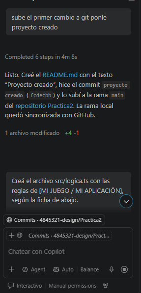
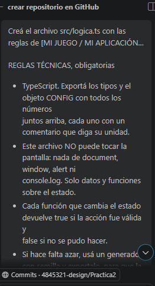
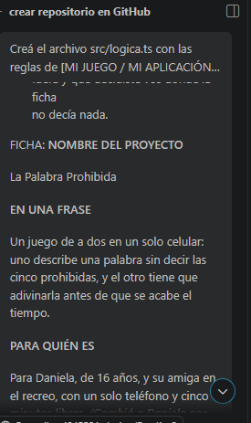
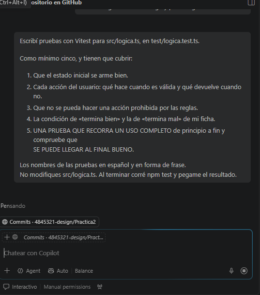
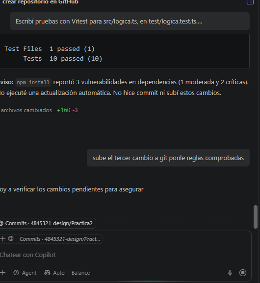
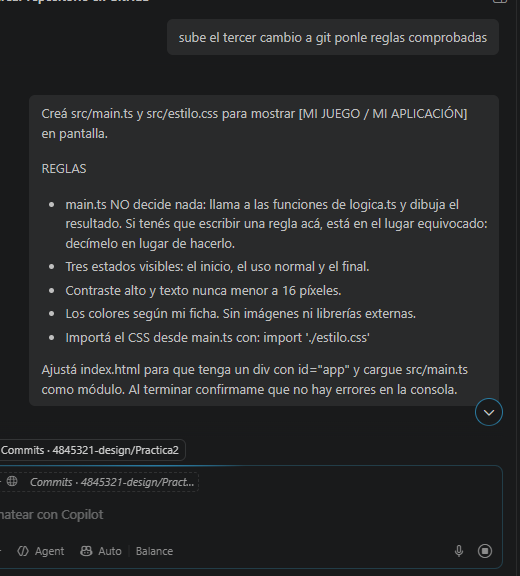
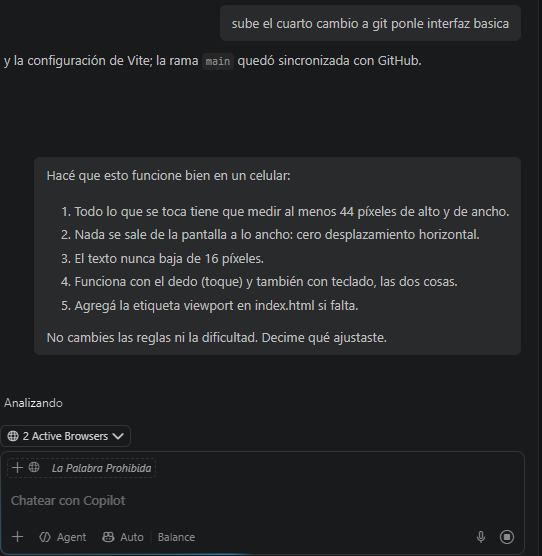
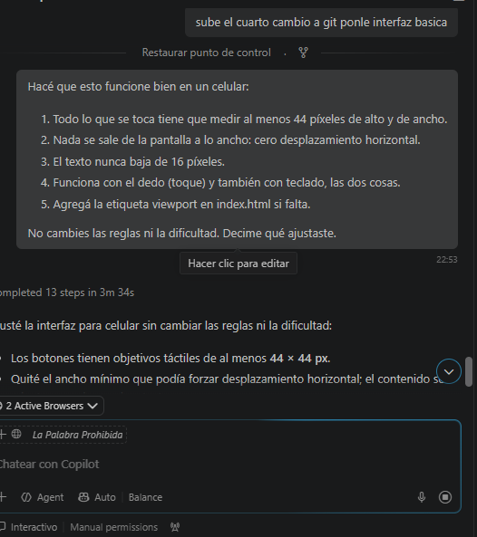
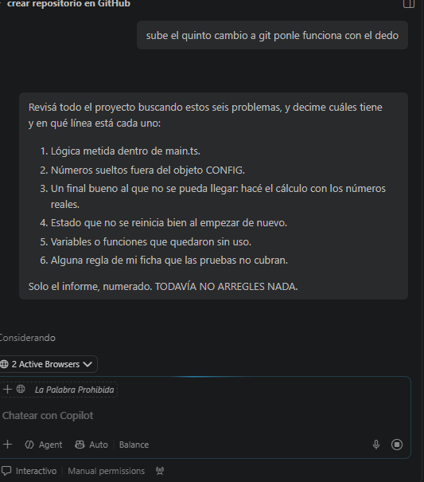
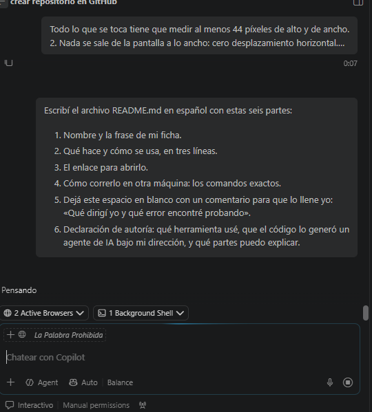

# La Palabra Prohibida

Juego de a dos para un solo celular: una persona describe una palabra sin decir
ninguna de sus cinco palabras prohibidas y la otra intenta adivinarla antes de
que se acabe el tiempo.

## Objetivo y reglas

- Adivinar cinco palabras en una ronda de 60 segundos.
- Cada acierto suma un punto y muestra otra carta.
- Si se dice una de las palabras prohibidas, se marca una falta y aparece otra
  carta.
- La ronda se gana con cinco aciertos y menos de tres faltas.
- La ronda se pierde cuando el tiempo llega a cero o se acumulan tres faltas.
- Hay siete cartas: PUPUSA, CHILATE, CANTÓN, CELULAR, SEMÁFORO, VOLCÁN y
  MERCADO. Al agotarse el mazo, las cartas usadas se barajan de nuevo sin repetir
  inmediatamente la carta actual.

## Cómo jugar

1. Abre el juego y pulsa **Empezar**.
2. Describe la palabra que aparece sin mencionar ninguna de las cinco
   prohibidas; quien adivina puede ver la carta en el mismo celular.
3. Pulsa **¡Acertó!** si adivinó o **Dijo una prohibida** si se dijo una palabra
   prohibida.
4. Sigue hasta ganar o hasta que se acabe el tiempo o se llegue a tres faltas.

### Controles

| Acción | Teclado | Pantalla táctil |
| --- | --- | --- |
| Empezar o reiniciar | `Enter` | **Empezar** / **Jugar de nuevo** |
| Marcar un acierto | `Espacio` | **¡Acertó!** |
| Marcar una falta | `F` | **Dijo una prohibida** |

La interfaz está adaptada a celulares: objetivos táctiles de al menos 44 × 44
píxeles, texto de al menos 16 píxeles y sin desplazamiento horizontal en las
anchuras móviles verificadas. El temporizador se resalta cuando quedan menos
de diez segundos; el verde identifica los aciertos y el rojo las palabras
prohibidas y las faltas.

## Tecnologías y estructura

- TypeScript para los tipos y las reglas en [`src/logica.ts`](./src/logica.ts).
- Interfaz y eventos de teclado/toque en [`src/main.ts`](./src/main.ts).
- Estilos adaptables en [`src/estilo.css`](./src/estilo.css).
- Vitest para las pruebas automatizadas en [`test/logica.test.ts`](./test/logica.test.ts).
- Vite para ejecutar el servidor local y generar la compilación.

## Cambios realizados

1. **Repositorio inicial:** creación del repositorio `Practica2` y un README
   inicial.
2. **Lógica del juego:** configuración centralizada, tipos, siete cartas,
   estado de ronda, puntuación, faltas, temporizador, generador con semilla y
   mazo que se vuelve a barajar.
3. **Pruebas automatizadas:** diez pruebas de Vitest para el estado inicial,
   acciones válidas e inválidas, victoria, derrotas y una ronda completa que
   llega al final bueno.
4. **Interfaz básica:** pantalla de inicio, ronda y resultado; carta y
   prohibidas visibles; marcador, temporizador, controles y estados de victoria
   o derrota.
5. **Adaptación móvil:** controles táctiles y teclado, objetivos grandes,
   viewport para celulares y ajustes para evitar el desbordamiento horizontal.
6. **Pulido y documentación:** estilos visuales, medidas conservadas, README
   ampliado y actualización de Vitest a una versión sin vulnerabilidades según
   `npm audit`.

## Abrir el proyecto

El código está en el [repositorio de GitHub](https://github.com/4845321-design/Practica2).
El juego no está desplegado como sitio web público; para jugarlo, ejecútalo
localmente con los pasos siguientes.

## Ejecutar en otra máquina

Instala Git y Node.js con npm. Desde una terminal, ejecuta:

```bash
git clone https://github.com/4845321-design/Practica2.git
cd Practica2
npm install
npm run dev
```

Abre la dirección que muestre Vite (normalmente
[http://localhost:5173](http://localhost:5173)).

Para correr las pruebas y crear la compilación de producción:

```bash
npm test
npm run build
```

## Evidencias

Las capturas originales se copiaron a [`docs/evidencias/`](./docs/evidencias/).

### Requisitos y ficha







### Implementación y pruebas













### Revisión del proyecto



## Dirección y autoría

### Qué dirigí yo y qué error encontré probando

Dirigí la definición del juego a partir de la ficha: sus reglas, objetivo,
controles de teclado y táctiles, adaptación a celular, pruebas y documentación.
Al revisar las dependencias encontré que Vitest tenía tres vulnerabilidades
reportadas (una moderada y dos críticas). Actualicé Vitest y confirmé con
`npm audit` que el proyecto quedó sin vulnerabilidades reportadas.

### Declaración de autoría

Usé GitHub Copilot en VS Code. El código lo generó un agente de inteligencia
artificial bajo mi dirección. Puedo explicar las reglas y estados de la ronda,
el generador aleatorio con semilla y el mazo, los controles de teclado y toque,
la interfaz adaptable y las pruebas automatizadas con Vitest.
